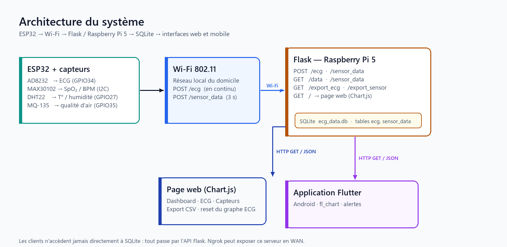
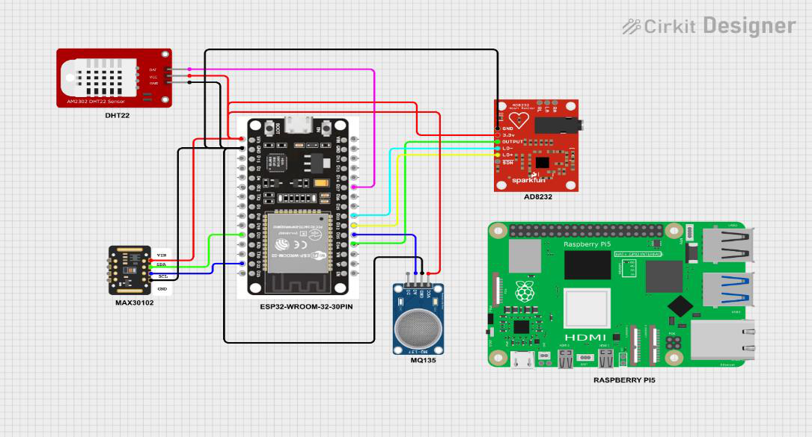
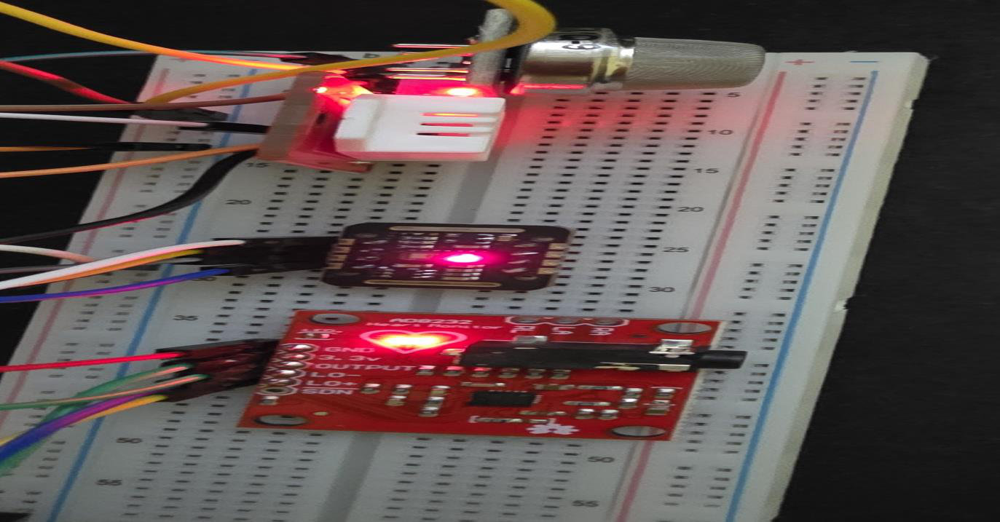
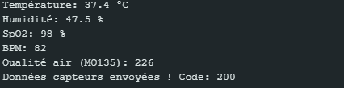
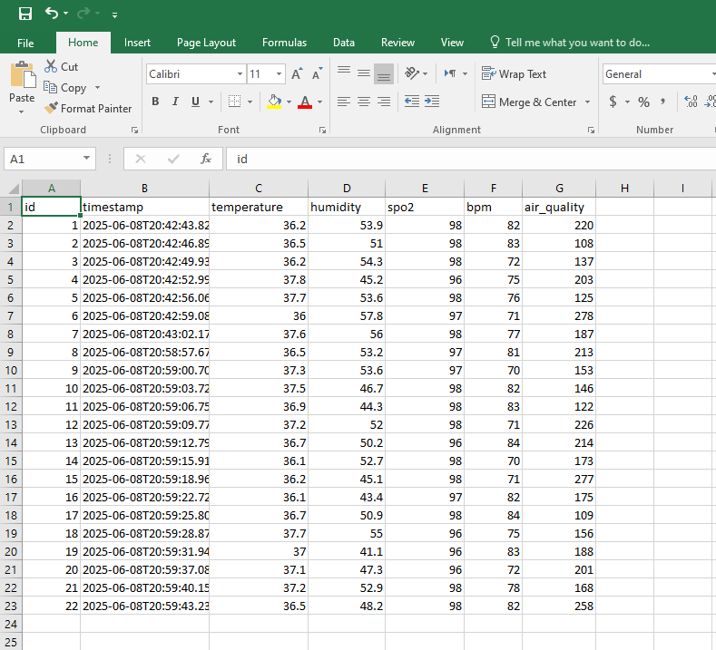
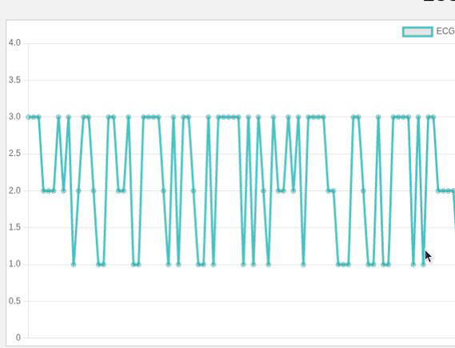
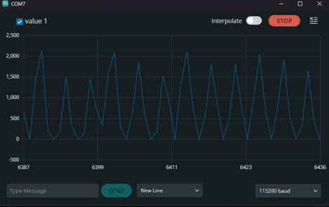

# Health Monitor IoT: real-time vital signs over Wi-Fi

[](https://github.com/amine-belkacem/health-monitor-iot/actions/workflows/ci.yml)

An ESP32 reads an ECG front-end (AD8232), a pulse oximeter (MAX30102), a temperature/humidity sensor (DHT22) and an air quality sensor (MQ-135), then posts the values over Wi-Fi to a Flask server running on a Raspberry Pi 5. The data goes into SQLite and is shown live on a web page and in an Android app written in Flutter.

## Project context

This was my Master's thesis (M2 Electronics, Embedded Systems, USTHB, Algiers, defended in June 2025). I did the whole project on my own: hardware wiring, ESP32 firmware, server, database, web page, mobile app and the tests on the real setup.

The repository was put together in 2026, after the thesis. Part of the original files were lost, so I want to be clear about what comes from where:

| Part | Origin |
|------|--------|
| `server/app.py` | Thesis code (appendix), one change: `/data` also returns the row `id` |
| `firmware/esp32_thesis_original/` | Thesis code (appendix), Wi-Fi credentials removed |
| `firmware/esp32_health_monitor/` | Corrected version written after the thesis (see [Results](#results)) |
| `server/templates/index.html` | The CSS is from the thesis, the HTML and JavaScript were rewritten |
| `mobile/` | Rewritten after the thesis, same screens as the original app |
| `hardware/` | Redrawn from the thesis pin table, the original EasyEDA project was not kept |
| `docs/images/` | Screenshots and photos taken during the thesis |

## Why this project?

The idea came from a discussion with a general practitioner who wanted something simple to follow patients at home: see the vital signs in real time and keep a record of them, without sending medical data to a third-party cloud.

That last point drove most of the choices. The server is a Raspberry Pi on the local network that I configured myself, so the data never leaves the house unless I open a tunnel on purpose. The ESP32 talks HTTP + JSON because it is the easiest protocol to debug: I could test every route with Postman before the hardware was even wired. Flask and SQLite were enough for one patient and run comfortably on a Pi 5.

## Architecture



| Module | Hardware / tech | Role |
|--------|-----------------|------|
| ECG | AD8232 → ESP32 GPIO 34 (ADC1, 12 bits) | Heart electrical activity, lead-off detection on GPIO 32/33 |
| SpO2 / heart rate | MAX30102, I2C (GPIO 21/22) | Blood oxygen and BPM with the Maxim algorithm |
| Temperature / humidity | DHT22, GPIO 27 | Air next to the patient |
| Air quality | MQ-135, GPIO 35 | Raw ADC value (not calibrated in ppm) |
| Acquisition | ESP32 DevKit (WROOM-32) | Reads the sensors, `POST /ecg` and `POST /sensor_data` |
| Server | Raspberry Pi 5, Flask, SQLite | Stores the data, serves `GET /data`, `GET /sensor_data`, CSV export |
| Web page | HTML/JS + Chart.js | Dashboard, live ECG (every 500 ms), sensors (every 3 s), CSV export |
| Mobile app | Flutter (Android), fl_chart | Same views + alerts with editable thresholds |
| Remote access | Ngrok | Temporary public URL for tests outside the LAN |

Wiring from the thesis (Cirkit Designer):



The full pin map and the redrawn schematic/PCB are in [`hardware/`](hardware/wiring.md).

## Results

### What worked on the real setup (June 2025)



- All four sensors were read by the ESP32 and the values reached the Flask server, the database, the web page and the Android app.

  

- **Sensor data**: 22 readings recorded over two sessions on 8 June 2025. The interval between two readings was 3.07 s (median), very close to the 3 s timer in the firmware, the extra time being the sensor reads and the HTTP request. Two longer gaps (3.76 s and 5.14 s) show the loop is not strictly periodic.

  | Measure | Min | Max |
  |---------|-----|-----|
  | Temperature (DHT22) | 36.0 °C | 37.8 °C |
  | Humidity | 41.1 % | 57.8 % |
  | SpO2 | 96 % | 98 % |
  | Heart rate | 70 BPM | 84 BPM |
  | Air quality (raw ADC) | 108 | 278 |

  The DHT22 measures air, not body temperature. These values are the air right next to the skin.

  

- **Remote access**: through Ngrok, the web page and the app worked from a phone on 4G and from a PC on another Wi-Fi network, without changing any client code. Ngrok reported a latency of 148 ms to its edge server.

### What did not work, and what I fixed after the thesis

Going back through the thesis code, I found that the ECG part did not do what the report described:

1. **ECG truncated to whole volts.** The thesis firmware did `int ecgValue = analogRead(34) * (3.3 / 4095.0);`. The result is stored in an `int`, so the only possible values are 0, 1, 2 and 3. That is exactly what the web graph from the thesis shows: steps between 1 and 3, not a heartbeat.

   

   The raw signal was fine on the Arduino Serial Plotter (values up to about 2100 on the 0–4095 scale), so the problem was only the conversion:

   

2. **Missing offset in the mV conversion.** The AD8232 output is centred on Vref/2 (1.65 V). The formula in the report divided the voltage by the gain without removing that offset, so a flat signal read as 1.5 mV instead of 0. The corrected formula is in [`ecg_conversion.h`](firmware/esp32_health_monitor/ecg_conversion.h):

   `V_ECG (mV) = (ADC × 3.3 / 4095 − 1.65) / 1100 × 1000`

   With ADC = 2048 (no signal) it gives 0.000 mV, against 1.500 mV with the old formula.

3. **ECG sample rate far below what an ECG needs.** One HTTP request per sample, plus about 1 s every 3 s where the loop was blocked reading the MAX30102. In the database, ECG rows were 1 to 20 s apart. An ECG needs at least 250 samples per second.

4. **MAX30102 read in a blocking loop, at the wrong rate.** The default `setup()` samples at 100 Hz while the Maxim algorithm expects 25 Hz, which skews the BPM. The corrected firmware configures 25 Hz and empties the sensor FIFO on each pass of `loop()` without blocking.

5. **Lead-off pins wired but never read.** LO+ and LO- are now checked: when an electrode comes off, no ECG sample is sent.

Fixes 1, 2, 4 and 5 are in `firmware/esp32_health_monitor/`. Fix 3 needs a different transport (see the limitations section). I no longer have the hardware, so the corrected firmware has not been flashed and tested on the real sensors yet.

### Checks I ran on the code (2026)

- Flask server: every route tested with real data from the thesis (the 22 readings above). Valid POST returns 200, missing fields return 400, the GET routes and CSV export return the stored data.
- Web page: tested in a browser against the Flask server; tabs, live update, ECG reset and CSV export all work.
- Firmware: both sketches (thesis and corrected) compile with arduino-cli for the ESP32 (core 3.3.12), about 80 % of the flash.
- Mobile app: `dart analyze` finds no issue, and 6 unit tests check the alert logic with the default thresholds of the app.
- Each test was also run once with a deliberate error (a wrong expected value, or a bug injected in the tested code) to make sure it really fails.
- Redrawn PCB: [`check_connectivity.py`](hardware/tools/check_connectivity.py) checks that every net connects all its pads. The first version of the redrawn board had 4 nets out of 9 not connected (LO+, LO-, SDA, SCL); after rerouting, 9/9 nets are connected, with no short and no crossing on the same layer.

## Repository structure

```
health-monitor-iot/
├── firmware/
│   ├── esp32_health_monitor/     corrected firmware (Arduino)
│   └── esp32_thesis_original/    firmware from the thesis appendix
├── server/                       Flask + SQLite, web page in templates/
├── mobile/                       Flutter app (lib/ + pubspec.yaml)
├── hardware/                     pin map, schematic, Gerbers, check scripts
├── tests/                        server and ECG conversion tests
├── docs/                         architecture diagram, thesis figures, report (PDF, French)
└── .github/workflows/ci.yml      runs the tests on every push
```

## How to run

### Server (Raspberry Pi or any PC)

```bash
cd server
python3 -m venv .venv
source .venv/bin/activate        # Windows: .venv\Scripts\activate
pip install -r requirements.txt
python3 app.py
```

The server listens on port 5000 and creates `ecg_data.db` on first start. Open `http://<pi-ip>:5000/` in a browser for the web page.

### ESP32 firmware

1. Arduino IDE with the ESP32 board package, board **ESP32 Dev Module**.
2. Libraries: *DHT sensor library* (Adafruit) and *SparkFun MAX3010x Pulse and Proximity Sensor Library*.
3. Open `firmware/esp32_health_monitor/esp32_health_monitor.ino`, fill in `ssid`, `password` and the Pi IP in `ecgUrl` / `sensorUrl`, then upload.

### Mobile app

The repository only holds the Dart code, so the Android project has to be generated once:

```bash
cd mobile
flutter create . --platforms=android
flutter pub get
flutter run
```

Set the server address in `lib/services/api_service.dart` (`baseUrl`): the Pi IP on the LAN, or the Ngrok URL.

### Remote access

```bash
ngrok http 5000
```

### Tests

```bash
pip install -r server/requirements.txt pytest
pytest tests/
g++ -I firmware/esp32_health_monitor tests/test_ecg_conversion.cpp -o test_ecg && ./test_ecg
python hardware/tools/check_connectivity.py
cd mobile && flutter test
```

The CI runs all of this on every push, and also compiles both firmware sketches with arduino-cli.

## Limitations and possible improvements

- **ECG transport.** One HTTP POST per sample cannot reach 250 Hz. The next step would be to sample on a hardware timer, buffer about 125 samples and send them in one request every 0.5 s, or switch to MQTT/WebSocket.
- **No signal processing.** The ECG is raw. It needs a 0.5–40 Hz band-pass and a 50 Hz notch filter before anyone can read P, QRS and T waves.
- **ESP32 ADC.** It is not linear near 0 V and 3.3 V. A calibration with `esp_adc_cal` would give more accurate millivolts.
- **SpO2 and BPM** come from the Maxim reference algorithm and are indicative only. Finger movement easily makes them invalid.
- **MQ-135** gives a raw value. Converting it to ppm needs a calibration in clean air, and its heater should run at 5 V with a divider on the output.
- **Security.** The API has no authentication and the ESP32 sends plain HTTP on the LAN. Ngrok adds HTTPS outside, but not on the local link. Token authentication on the Flask routes would be the first thing to add.
- **Redrawn PCB** has not been through a DRC and was never manufactured.
- **Not a medical device.** The electrodes are connected to a person, so the prototype must run from a battery, never from a mains supply without isolation.

## Author

**Mohamed Amine Belkacem**, M2 student in Electronic and Communicating Systems at Université de Lorraine, previously M2 in Embedded Electronic Systems at USTHB.

- LinkedIn: [mohamed-amine-belkacem](https://www.linkedin.com/in/mohamed-amine-belkacem-262582391)
- GitHub: [amine-belkacem](https://github.com/amine-belkacem)

The full thesis (in French) is in [`docs/report.pdf`](docs/report.pdf).
